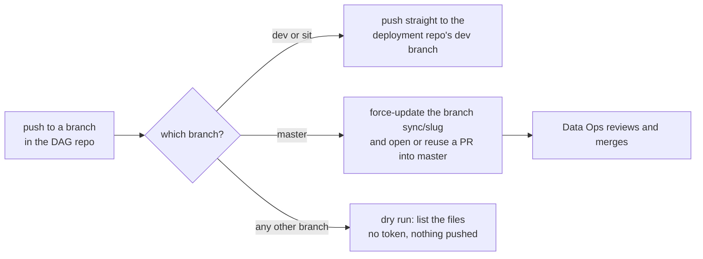

# Airflow DAG Sync Standard

The standard GitHub Actions workflow that publishes a DAG from a data repository into the shared Airflow deployment repository, where Data Ops deploys it. The template is [`templates/github-workflows/airflow-dag-sync/`](../../templates/github-workflows/airflow-dag-sync/): the workflow `sync-dags.yml` and two scripts, `scripts/sync_dags.sh` and `scripts/publish_dags.sh`. A second workflow, `sync-dags.github-app.yml`, is the same workflow with a GitHub App token instead of a stored personal access token (section 4).

First built for an Airflow whitelist repo and reused unchanged, apart from names, for a second DAG repo on 2026-10-15. This version replaces the hard-coded names with `env:` values and adds input checks, so a third repo only edits one block. Every rule below exists because of something that broke or could break, noted in the *Why* column.

## 1. How it works



| Event in the DAG repo | Target in the deployment repo | Who merges |
| --- | --- | --- |
| Push to `dev` or `sit` touching `dags/**` or the sync files | Direct commit on the dev branch (default `airflow-dev`), one rebase retry | Nobody, it is already there |
| Push to `master` touching the same paths | Branch `sync/<slug>` (force-updated per run) and a PR into `master`, reused while open | Data Ops |
| Manual dispatch on any branch | Same rules by branch; a branch other than the three runs the dry run only | n/a |

The scripts copy exactly two things: the DAG file `airflow/dags/<DAG_EXECUTOR>` and the folder `airflow/dags/<DAG_UTILS>/`, which is replaced as a whole. Nothing else in the deployment repo is touched, so other teams' DAGs in the same folder are safe.

## 2. Adopting it in a repository

1. Lay the repo out as `dags/<DAG_EXECUTOR>` plus `dags/<DAG_UTILS>/` (the DAG file and its helper folder).
2. Pick the token variant (section 4), then copy that workflow file to `.github/workflows/sync-dags.yml` (the name is the same for both variants) and the two scripts to `scripts/`.
3. Replace the six `TODO` values in the workflow's `env:` block:

   | Variable | Meaning |
   | --- | --- |
   | `DEPLOY_REPO` | `owner/name` of the Airflow deployment repository |
   | `DEPLOY_DEV_BRANCH` | Branch that `dev` and `sit` publish to |
   | `DAG_DEST_DIR` | DAG folder inside the deployment repo (default `airflow/dags`) |
   | `DAG_SLUG` | Short kebab-case name, used for the `sync/<slug>` branch, the PR title and the bot's git name |
   | `DAG_EXECUTOR` | The DAG file under `dags/`, ending in `.py` |
   | `DAG_UTILS` | The helper folder under `dags/` |

4. Create the GitHub setup in section 4.
5. Test it in the order of section 6 before relying on it.
6. Add the repo's own checks for the sync (section 7).

## 3. Rules

| # | Rule | Why |
| --- | --- | --- |
| 1 | The write credential (the PAT, or the App's private key) is stored only as an organization secret or as a secret of the Environment `airflow-sync` (limited to the branches `master`, `dev` and `sit`). Never create it as a repository-level secret. An organization secret shared with the DAG repositories is the default because an admin manages it centrally; it trades the branch restriction for that (section 4). | A repository-level secret is readable from every branch and bypasses the Environment's branch restriction, with no central owner. An Environment secret overrides a repo secret of the same name, so the repo-level copy adds exposure and no function. |
| 2 | The workflow's own `GITHUB_TOKEN` is `contents: read`. | Write access to the deployment repo comes only from that secret. |
| 3 | Only `master`, `dev` and `sit` reach the `sync` job (checked by `if:` as well as by the Environment). Any other branch runs the `dry-run` job, which has no `environment:` and no `secrets.*`. | A feature branch must be able to show what a sync would copy without being able to push. |
| 4 | `master` publishes through a PR, never a direct push. `dev` and `sit` push directly. | Production DAGs are reviewed by Data Ops; the dev branch is shared with other teams and changes often. |
| 5 | The bot branch `sync/<slug>` is pushed with `--force-with-lease=<branch>:<current remote tip>`, the tip read with `git ls-remote`. | A fresh clone has no tracking ref for that branch, so a bare `--force-with-lease` has nothing to compare and refuses. An empty tip means the branch must not exist yet. |
| 6 | A direct push retries once after `git pull --rebase`. | Other teams push to the same branch at any time. |
| 7 | `concurrency` groups by target (`master` or the dev branch), `cancel-in-progress: false`. | Two runs on one target would race on the same branch. Queue them; cancelling could drop a sync. |
| 8 | The scripts take their names from the environment and reject anything but plain names (`[A-Za-z0-9_]`, `.py` for the file, relative folders for the destination). | The values reach `rm -rf` and `git add`. A name like `..` must fail before anything is removed. |
| 9 | Workflow values reach shell scripts only through `env:`, never as `${{ ... }}` inside `run:`. | Prevents shell injection through ref names or inputs. |
| 10 | Every `run:` step sets `shell: bash`; checkout uses `persist-credentials: false`. | `shell: bash` turns on `pipefail`, so a failing script is not hidden by `tee`. The checkout does not need to keep a token. |
| 11 | Write the run summary through `tee -a "$GITHUB_STEP_SUMMARY"`. | The step log then shows the real values as well as the summary page. |
| 12 | A commit that changes nothing publishes nothing (`git diff --cached --quiet`). | A rerun, or a push that touched only the sync files, must not create empty commits or PR noise. |

## 4. Token: choose a variant and set up GitHub

The sync needs to write to a repository other than its own, which the workflow's built-in token cannot do. Two variants give it that access; the rest of the workflow is identical (a test keeps the `dry-run` job and the `env:` block the same in both).

| | Personal access token (`sync-dags.yml`) | GitHub App (`sync-dags.github-app.yml`) |
| --- | --- | --- |
| Owner | A bot or service account (a token is always owned by a user) | The organization |
| Lifetime | Fixed expiry, renewed by hand | A one-hour token per run; the private key is rotated only when wanted |
| Tied to a person | Only if a person's account owns it; use a bot account | No |
| Scope | One repository, set when the token is created | One repository: the installation, narrowed again in the workflow (`repositories:` and `permission-*`) |
| Who acts in the deployment repo | The token's owner | The App (PRs and commits show the App as author) |
| Needs an org admin | Yes, to create the token under a bot account and store the organization secret | Yes, once, to create and install the App |
| Use when | The admin prefers one managed token (default); without an admin, a token in each Environment | An admin can create and install the App (no expiry to renew) |

Both variants keep the `sync` job on the Environment `airflow-sync` (the job names it; GitHub creates it without branch limits if it is missing, so create it properly). In the DAG repository: **Settings > Environments > New environment** named `airflow-sync`, *Deployment branches and tags* set to *Selected branches and tags* with `master`, `dev` and `sit`.

### 4.1 Personal access token

1. **Token.** A fine-grained personal access token for the **deployment repository only**: *Resource owner* the organization, *Repository access* that one repository, *Contents: read and write* (clone and push) and *Pull requests: read and write* (open and look up the PR). A token is always owned by a user, so create it under a bot or service account that has the write role on the deployment repository (the organization may have to allow fine-grained tokens and approve this one). Give it an expiry and note the renewal date; an expired token fails the `Clone` step with an authentication error.
2. **Where it lives**, named `DA_AIRFLOW_SYNC_TOKEN`:
   - **Organization secret (default).** An org admin creates the token and stores it once as an organization secret with *Repository access* set to *Private repositories* (or *Selected repositories*). GitHub has no name-pattern option, so a prefix such as `da-` cannot be used. Any matching repository then reads `secrets.DA_AIRFLOW_SYNC_TOKEN` as soon as it has the workflow, with nothing else to configure, and renewal is one update. The DAG owners never see the value. The cost is the branch restriction: a workflow on any branch of those repositories can read it, so keep the token limited to the deployment repository and protect that repository's `master` with a ruleset that requires a pull request.
   - **Environment secret.** Add it to the Environment `airflow-sync` of each DAG repository. Only `master`, `dev` and `sit` can read it, but someone must copy the value into every repository.
3. Confirm no repository-level `DA_AIRFLOW_SYNC_TOKEN` exists: `gh secret list` must not show it. An Environment secret of the same name overrides the organization secret, so remove a leftover Environment copy (or the old `DEPLOY_REPO_TOKEN`) when moving to the organization secret.

### 4.2 GitHub App

An organization admin does this once; with organization secrets a DAG repository then needs nothing more than the workflow.

1. **Create the App** in the organization (*Settings > Developer settings > GitHub Apps > New GitHub App*). Repository permissions: *Contents: read and write*, *Pull requests: read and write* (*Metadata: read* is added automatically). No webhook, no user authorization. Allow installation on this organization only.
2. **Install it on the deployment repository only** (*Only select repositories*). Do not install it on "all repositories".
3. **Generate a private key** (a `.pem` file) and note the App's **Client ID**.
4. Store both values as **organization secrets**, shared with the DAG repositories only (*Selected repositories*, never *All repositories*): `DA_AIRFLOW_SYNC_APP_CLIENT_ID` (the Client ID) and `DA_AIRFLOW_SYNC_APP_PRIVATE_KEY` (the whole PEM, including the `BEGIN` and `END` lines). The Client ID is not sensitive, but keeping both as secrets means the workflow reads them the same way and the DAG owners never see either value. A new DAG repository only needs adding to the sharing list. Delete the downloaded `.pem` afterwards.
5. If stricter isolation is wanted, store the two as secrets in the Environment `airflow-sync` of each DAG repository instead (restricted to `master`, `dev` and `sit`, but the admin must add them to every repository). The workflow file is the same either way.

**Trade-off of the organization secret.** GitHub has no organization-wide Environment, so an organization secret shared with a repository is readable by a workflow on **any** branch of it; the branch restriction of rule 1 does not apply. Anyone who can push a branch to a DAG repository could write a workflow that uses the App to push to the deployment repository. Keep that risk small: share the secret only with the DAG repositories, keep the App installed on the deployment repository alone, and protect the deployment repository's `master` with a ruleset that requires a pull request (so the App can write to the development branch but cannot merge to `master`). If the team cannot accept that, use the Environment secret instead. 

In the deployment repository: the dev branch (default `airflow-dev`) and `master` must exist. If `master` is protected, a PR is the only way in, which the `master` path already is. With a PAT the token's owner needs write access; with the App the installation grants it.

### 4.3 Options beyond a token

If the platform team is involved anyway, two structural alternatives remove the cross-repository write permission from the DAG repositories altogether. Both are the platform team's decision, not something this template implements.

| Option | How it works | Trade-off |
| --- | --- | --- |
| Pull instead of push | A workflow in the deployment repository, owned by the platform team, checks out each DAG repository (read-only access) on a schedule or on a `repository_dispatch` and opens its own PR. | No write credential in the DAG repositories, but the platform team now maintains the list of DAG repositories and the schedule or trigger. |
| Airflow `git-sync` | Airflow reads each DAG repository directly with a read-only deploy key. | No copy step and no deployment repo for these DAGs, but it changes how Airflow is deployed, so it needs the platform team to own the rollout. |

## 5. What the scripts do

`scripts/sync_dags.sh <source_repo_dir> <deployment_repo_dir>` (needs `DAG_EXECUTOR`, `DAG_UTILS`, optional `DAG_DEST_DIR`):

- Exits 2 when a name is invalid or a source file is missing, 3 when the destination is not a deployment checkout (no DAG folder).
- Deletes and recreates `<DAG_DEST_DIR>/<DAG_UTILS>`, copies the source folder in, removes `__pycache__`, then copies the DAG file.

`scripts/publish_dags.sh <source_repo_dir> <clone_dir> <direct|pr> <base_branch> <source_sha>` (needs `DAG_SLUG` too):

- Checks out the base branch, creates `sync/<slug>` in `pr` mode, runs the sync, stages only the two paths, commits `chore(airflow): sync <slug> DAG from <repo>@<short sha>`, then pushes as described in section 1. Exits 2 for a bad mode or slug and 5 when the direct push fails twice.

Run either locally against a scratch clone to see what a sync would do:

```bash
DAG_SLUG=my-dag DAG_EXECUTOR=my_dag_executor.py DAG_UTILS=my_dag_utils \
  bash scripts/sync_dags.sh . /path/to/deployment-checkout
```

## 6. Testing a new adoption

Do these in order; each one proves a different rule.

1. **Feature branch dispatch:** `gh workflow run sync-dags.yml --ref <feature-branch>`. Only the `dry-run` job must run, and its summary lists the two paths. This proves rule 3.
2. **`sit` dispatch or push:** the `sync` job must succeed, with a new commit on the dev branch of the deployment repo, and a rerun must say *No changes to publish*. This proves the token, the Environment and rule 12.
3. **`master` push (the real release):** a PR from `sync/<slug>` into `master` must open, and a second push must update the same PR instead of opening another. This path cannot be tested earlier without publishing a production DAG.
4. **Negative check:** `gh secret list` shows no `DA_AIRFLOW_SYNC_TOKEN` and no `DA_AIRFLOW_SYNC_APP_PRIVATE_KEY` at repository level (rule 1); an organization-level App key is expected only when section 4.2 chose it. With the App variant, also check that the *Create the deployment repository token* step succeeds and that the PR in step 3 is authored by the App.

Evidence so far. In the first adopter (the negative-list repository), pushes to `sit`, `dev` and `master` succeeded on 2026-10-13 and 2026-10-14, and the `master` push opened a pull request into the deployment repository's `master`. In the second (the PD monitoring repository), five `sit` pushes succeeded on 2026-10-19 and 2026-10-20 and the repository-level secret was removed, leaving only the Environment secret. No feature-branch run (the dry-run job) was found in either repository when this was written.

## 7. Checks to keep in the DAG repo

The repo's tests should fail when the safety properties change. The template's own tests in `tests/test_airflow_dag_sync_template.py` show the pattern: run the scripts against a throwaway bare git repo (a direct push, a rebase over a concurrent push, a PR with a stubbed `gh`, a rerun that pushes nothing, unsafe names rejected) and check the workflow text for the allowlist, the read-only token, no `${{ }}` in `run:`, and no secret in the dry-run job.

## 8. Known limits

| Limit | Effect | Mitigation |
| --- | --- | --- |
| Deleting the DAG from the source repo removes nothing from the deployment repo. | A retired DAG stays deployed. | Remove it in the deployment repo by a normal PR. |
| `dev` and `sit` publish to the same branch. | The last push wins; a `sit` test run can be overwritten by a `dev` push. | Test one branch at a time, or give `sit` its own deployment branch. |
| Only `dags/**` and the sync files trigger a run. | A change elsewhere (the image, the Variables) is not published. | The DAG's image tag and Variables are set in Airflow; they are not part of this sync. |
| The token is placed in the clone URL, so it sits in the clone's `.git/config` on the runner. | Visible only inside the job, and GitHub-hosted runners are discarded after it. | Do not reuse this pattern on a self-hosted runner. |
| A `master` push that arrives while the previous PR is still open force-updates the same branch. | The PR shows the newest DAG only; earlier intermediate commits are replaced. | This is intended: Data Ops reviews the final diff. |
| A personal access token expires. | The `Clone` step fails with an authentication error. | Renew it and update the secret (one place for an organization secret), or switch to the App variant. |
| The App's installation or key is removed or rotated. | The *Create the deployment repository token* step fails. | Ask the admin to restore the installation, or put the new key in the secret. |
