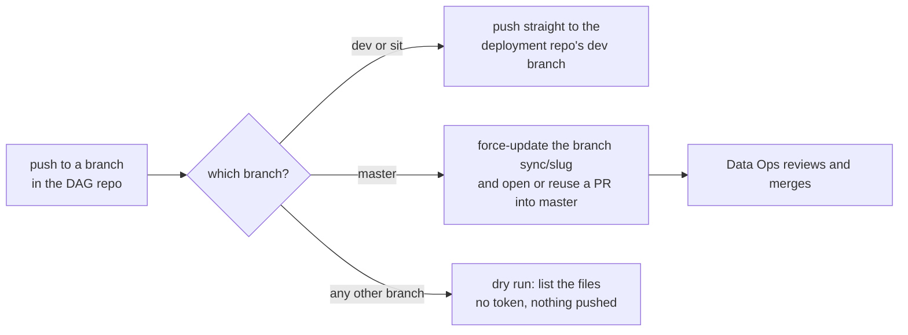

# Airflow DAG Sync Standard

The standard GitHub Actions workflow that publishes a DAG from a data repository into the shared Airflow deployment repository, where Data Ops deploys it. The template is [`templates/github-workflows/airflow-dag-sync/`](../../templates/github-workflows/airflow-dag-sync/): the workflow `sync-dags.yml` and two scripts, `scripts/sync_dags.sh` and `scripts/publish_dags.sh`.

First built for an Airflow whitelist repo and reused unchanged, apart from names, for a second DAG repo on 2026-10-15. This version replaces the hard-coded names with `env:` values and adds input checks, so a third repo only edits one block. Every rule below exists because of something that broke or could break, noted in the *Why* column.

## 1. How it works



| Event in the DAG repo | Target in the deployment repo | Who merges |
| --- | --- | --- |
| Push to `dev` or `sit` touching `dags/**` or the sync files | Direct commit on the dev branch (default `airflow-dev`), one rebase retry | Nobody, it is already there |
| Push to `master` touching the same paths | Branch `sync/<slug>` (force-updated per run) and a PR into `master`, reused while open | Data Ops |
| Manual dispatch on any branch | Same rules by branch; a branch other than the three runs the dry run only | n/a |

The scripts copy exactly two things: the DAG file `airflow/dags/<DAG_EXECUTOR>` and the folder `airflow/dags/<DAG_UTILS>/`, which is replaced as a whole. Nothing else in the deployment repo is touched, so other teams' DAGs in the same folder are safe.

## 2. Adopting it in a repository

1. Lay the repo out as `dags/<DAG_EXECUTOR>` plus `dags/<DAG_UTILS>/` (the DAG file and its helper folder).
2. Copy the three files: `sync-dags.yml` to `.github/workflows/`, the two scripts to `scripts/`.
3. Replace the six `TODO` values in the workflow's `env:` block:

   | Variable | Meaning |
   | --- | --- |
   | `DEPLOY_REPO` | `owner/name` of the Airflow deployment repository |
   | `DEPLOY_DEV_BRANCH` | Branch that `dev` and `sit` publish to |
   | `DAG_DEST_DIR` | DAG folder inside the deployment repo (default `airflow/dags`) |
   | `DAG_SLUG` | Short kebab-case name, used for the `sync/<slug>` branch, the PR title and the bot's git name |
   | `DAG_EXECUTOR` | The DAG file under `dags/`, ending in `.py` |
   | `DAG_UTILS` | The helper folder under `dags/` |

4. Create the GitHub setup in section 4.
5. Test it in the order of section 6 before relying on it.
6. Add the repo's own checks for the sync (section 7).

## 3. Rules

| # | Rule | Why |
| --- | --- | --- |
| 1 | The write token lives only in the Environment `airflow-sync`, limited to the branches `master`, `dev` and `sit`. Never also create it as a repository-level secret. | A repository-level secret is readable from every branch and bypasses the Environment's branch restriction. An Environment secret overrides a repo secret of the same name, so the repo-level copy adds exposure and no function. |
| 2 | The workflow's own `GITHUB_TOKEN` is `contents: read`. | Write access to the deployment repo comes only from the Environment secret. |
| 3 | Only `master`, `dev` and `sit` reach the `sync` job (checked by `if:` as well as by the Environment). Any other branch runs the `dry-run` job, which has no `environment:` and no `secrets.*`. | A feature branch must be able to show what a sync would copy without being able to push. |
| 4 | `master` publishes through a PR, never a direct push. `dev` and `sit` push directly. | Production DAGs are reviewed by Data Ops; the dev branch is shared with other teams and changes often. |
| 5 | The bot branch `sync/<slug>` is pushed with `--force-with-lease=<branch>:<current remote tip>`, the tip read with `git ls-remote`. | A fresh clone has no tracking ref for that branch, so a bare `--force-with-lease` has nothing to compare and refuses. An empty tip means the branch must not exist yet. |
| 6 | A direct push retries once after `git pull --rebase`. | Other teams push to the same branch at any time. |
| 7 | `concurrency` groups by target (`master` or the dev branch), `cancel-in-progress: false`. | Two runs on one target would race on the same branch. Queue them; cancelling could drop a sync. |
| 8 | The scripts take their names from the environment and reject anything but plain names (`[A-Za-z0-9_]`, `.py` for the file, relative folders for the destination). | The values reach `rm -rf` and `git add`. A name like `..` must fail before anything is removed. |
| 9 | Workflow values reach shell scripts only through `env:`, never as `${{ ... }}` inside `run:`. | Prevents shell injection through ref names or inputs. |
| 10 | Every `run:` step sets `shell: bash`; checkout uses `persist-credentials: false`. | `shell: bash` turns on `pipefail`, so a failing script is not hidden by `tee`. The checkout does not need to keep a token. |
| 11 | Write the run summary through `tee -a "$GITHUB_STEP_SUMMARY"`. | The step log then shows the real values as well as the summary page. |
| 12 | A commit that changes nothing publishes nothing (`git diff --cached --quiet`). | A rerun, or a push that touched only the sync files, must not create empty commits or PR noise. |

## 4. GitHub setup

In the DAG repository:

1. **Settings > Environments > New environment** named `airflow-sync`. Under *Deployment branches and tags* choose *Selected branches and tags* and add `master`, `dev` and `sit`.
2. Add the environment secret `DEPLOY_REPO_TOKEN`. It is a token for the **deployment repository only**. A fine-grained personal access token limited to that one repository needs *Contents: read and write* (clone and push) and *Pull requests: read and write* (open and look up the PR). Give it an expiry and note the renewal date; an expired token fails the `Clone` step with an authentication error.
3. Confirm there is no repository-level `DEPLOY_REPO_TOKEN`: `gh secret list` must not show it.

In the deployment repository: the token's owner needs write access, and the dev branch (default `airflow-dev`) and `master` must exist. If `master` is protected, a PR is the only way in, which the `master` path already is.

## 5. What the scripts do

`scripts/sync_dags.sh <source_repo_dir> <deployment_repo_dir>` (needs `DAG_EXECUTOR`, `DAG_UTILS`, optional `DAG_DEST_DIR`):

- Exits 2 when a name is invalid or a source file is missing, 3 when the destination is not a deployment checkout (no DAG folder).
- Deletes and recreates `<DAG_DEST_DIR>/<DAG_UTILS>`, copies the source folder in, removes `__pycache__`, then copies the DAG file.

`scripts/publish_dags.sh <source_repo_dir> <clone_dir> <direct|pr> <base_branch> <source_sha>` (needs `DAG_SLUG` too):

- Checks out the base branch, creates `sync/<slug>` in `pr` mode, runs the sync, stages only the two paths, commits `chore(airflow): sync <slug> DAG from <repo>@<short sha>`, then pushes as described in section 1. Exits 2 for a bad mode or slug and 5 when the direct push fails twice.

Run either locally against a scratch clone to see what a sync would do:

```bash
DAG_SLUG=my-dag DAG_EXECUTOR=my_dag_executor.py DAG_UTILS=my_dag_utils \
  bash scripts/sync_dags.sh . /path/to/deployment-checkout
```

## 6. Testing a new adoption

Do these in order; each one proves a different rule.

1. **Feature branch dispatch:** `gh workflow run sync-dags.yml --ref <feature-branch>`. Only the `dry-run` job must run, and its summary lists the two paths. This proves rule 3.
2. **`sit` dispatch or push:** the `sync` job must succeed, with a new commit on the dev branch of the deployment repo, and a rerun must say *No changes to publish*. This proves the token, the Environment and rule 12.
3. **`master` push (the real release):** a PR from `sync/<slug>` into `master` must open, and a second push must update the same PR instead of opening another. This path cannot be tested earlier without publishing a production DAG.
4. **Negative check:** `gh secret list` shows no `DEPLOY_REPO_TOKEN` (rule 1).

Status of the first adopter: five `sit` pushes succeeded (2026-10-19 and 2026-10-20) and the repository-level secret has been removed, leaving only the Environment secret. The feature-branch dry run and the `master` PR path had not run yet when this was written.

## 7. Checks to keep in the DAG repo

The repo's tests should fail when the safety properties change. The template's own tests in `tests/test_airflow_dag_sync_template.py` show the pattern: run the scripts against a throwaway bare git repo (a direct push, a rebase over a concurrent push, a PR with a stubbed `gh`, a rerun that pushes nothing, unsafe names rejected) and check the workflow text for the allowlist, the read-only token, no `${{ }}` in `run:`, and no secret in the dry-run job.

## 8. Known limits

| Limit | Effect | Mitigation |
| --- | --- | --- |
| Deleting the DAG from the source repo removes nothing from the deployment repo. | A retired DAG stays deployed. | Remove it in the deployment repo by a normal PR. |
| `dev` and `sit` publish to the same branch. | The last push wins; a `sit` test run can be overwritten by a `dev` push. | Test one branch at a time, or give `sit` its own deployment branch. |
| Only `dags/**` and the sync files trigger a run. | A change elsewhere (the image, the Variables) is not published. | The DAG's image tag and Variables are set in Airflow; they are not part of this sync. |
| The token is placed in the clone URL, so it sits in the clone's `.git/config` on the runner. | Visible only inside the job, and GitHub-hosted runners are discarded after it. | Do not reuse this pattern on a self-hosted runner. |
| A `master` push that arrives while the previous PR is still open force-updates the same branch. | The PR shows the newest DAG only; earlier intermediate commits are replaced. | This is intended: Data Ops reviews the final diff. |
| The token expires. | The `Clone` step fails with an authentication error. | Renew it and update the Environment secret. |
