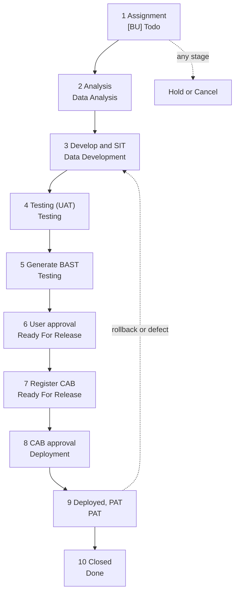

# Dev workflow: the full pipeline

How a change moves from assignment to a closed ticket, and what each Claude Code skill or
command, the logbook, the CAB register and the ticket handover do at each step. Jira, git and
the weekly report use the same stage words, so they agree. Nothing is committed, pushed,
transitioned or logged without the user's OK; every step below only proposes.

## Overview



The flow is forward-only; the dotted lines are the exceptions (section "Side tracks").

## Stages

Jira order: `Data Analysis` → `Data Development` → `Testing` (UAT) → `Ready For Release`
(CAB) → `Deployment` (CAB approved) → `PAT` (deployed, production assurance test) → `Done`
(no error one week after PAT). `Hold` can occur at any point.

| # | Stage and Jira status | Git / GitHub | Claude tooling | Logbook status | Handover and CAB register |
| --- | --- | --- | --- | --- | --- |
| 1 | Assignment: `[BU] Todo` | none | `jira-in-da-sync` clones the IN ticket into a DA ticket and links it back | none yet | none |
| 2 | Analysis: `Data Analysis` | kickoff creates the `fea/` or `fix/` branch off `dev` and the `release/<TICKET>/` folders; spec and plan are committed | `jira-ticket-kickoff`, `brainstorming`, `writing-plans`, `/commit` | `Analysis` | handover file created; objects named in the plan recorded as `planned` |
| 3 | Develop and SIT: `Data Development` | commits on the branch; optional merge into `sit` for internal testing | `/commit`, code review skills | `Development` | every object a change artifact touches recorded as `touched` |
| 4 | Testing, UAT: `Testing` | PR to `dev` opened, not merged | `/generate-pr-message` (PR 1, changelog), the Jira status check | `Testing` | PR link set; Jira handover comment proposed |
| 5 | Generate BAST: `Testing` (no change) | PR still open | `bast-generator` | none | BAST scope compared with the handover inventory; BAST link recorded |
| 6 | User approval: `Ready For Release` | PR squash-merged into `dev` | the Jira move is proposed | `Ready For Release` | none: a merge is not a handover trigger |
| 7 | Register CAB: `Ready For Release` (no change) | `dev` to `master` PR (merge commit), may merge directly | `/generate-pr-message` (PR 2), BAST update with user capture and approval | `Ready For Release` | register row appears (registered date); production objects added to the handover |
| 8 | CAB approval: `Deployment` | none required (`master` may already be merged) | the user moves the ticket | `Deployment` | register: CAB date and planned deploy |
| 9 | Deployed, PAT: `PAT` | none | the user moves the ticket; `/pipeline` watches the PAT window | `PAT` | register: real deploy date and planned PAT end |
| 10 | Closed: `Done` | branch cleanup with `/clean-gone` | the board proposes `Done` on the planned PAT end; Jira and logbook are written after the OK | `Done`, archived 7 days later | last handover post; the file stays as the record |

A merge into `master` is not the release gate and never means deployed: deployment starts
only after CAB approval.

## Side tracks

- **`Hold`** (any stage): the board shows only the hold date and gives no workflow prompts.
- **Rollback or a defect after release:** the ticket goes back to `Data Development` or `Bug
  Fixing`, the logbook uses `Fixing`, and the register gets a new CAB row (bugfix or emergency)
  for the same ticket.
- **`Cancel`:** the Jira status `Cancel`; the ticket leaves the board.
- **Personal work with no company ticket** (logbook tooling and other personal projects used
  only by their owner on their own device): no Jira flow, no CAB, no `Deployment` or `PAT`. It is
  done once it is committed and PR-ed to `master`; set the logbook row to `Done` then.

## Files and folders per ticket

```text
release/<TICKET>/            committed with the change
  CHANGELOG.md               written by /generate-pr-message
  docs/                      requirement or spec, design, decisions, HANDOVER.md
  ddl/ flink/ data/ config/  the production change; no DataWorks nodes here

scratch/                     gitignored, never committed; only objects outside the repo
  <category>/                the full existing production state (ddl, dataworks, flink, ...)
  <TICKET>/                  CONTEXT.md, samples, and the dev form of this ticket's changes
```

Production changes are generated into `release/`, the same change for the dev environment goes
into `scratch/<TICKET>/`, and DataWorks nodes exist only in `scratch/` and in DataWorks itself.
After release the `scratch/<category>/` files are brought to the new production state.

## Logbook statuses

| Logbook status | Weekly page word | Jira status |
| --- | --- | --- |
| `Analysis` | `ANALYST` | `Data Analysis` |
| `Development` | `DEVELOPMENT` | `Data Development` |
| `Testing` | `TESTING` | `Testing` |
| `Ready For Release` | `READY FOR RELEASE` | `Ready For Release` |
| `Deployment` | `DEPLOYMENT` | `Deployment` |
| `PAT` | `PAT` | `PAT` |
| `Done` | `DONE` | `Done` |
| `Fixing` | `FIXING` | none |
| `Hold` | `HOLD` | `Hold` |

When Jira and the logbook disagree on status, Jira wins; `logbook.py check` reports the
difference and proposes the logbook update.

## Trigger prompts

Each event proposes the next step when it happens and never acts without an OK.

| Event | Prompt |
| --- | --- |
| Assignment cloned (`jira-in-da-sync`) | Start the ticket (kickoff) or leave it |
| Kickoff done | Move Jira to `Data Analysis` or `Data Development`; logbook `Analysis` or `Development` |
| PR to `dev` opened | Jira to `Testing`; logbook `Testing`; offer `bast-generator`; handover post if the inventory changed |
| BAST generated | Remind to send for UAT; no status change |
| PR to `dev` merged | Jira to `Ready For Release`; logbook `Ready For Release`; offer the `dev` to `master` PR and the BAST update |
| PR to `master` opened or merged | No Jira change; remind that CAB approval moves the ticket to `Deployment` |
| Ticket seen in `Deployment` | Logbook `Deployment` |
| Ticket seen in `PAT` | Logbook `PAT`; note the date, so day 7 is known |
| PAT planned end reached | Jira and logbook to `Done` in one batch; offer `/clean-gone` |

## Operating rules

- Claude proposes, the user approves: commits, pushes, PRs, Jira transitions and logbook rows
  are written only after an OK. Recording that only touches local files (the handover
  inventory) is silent.
- Branches: work branches come off `dev` and are squash-merged into it; `dev` is promoted to
  `master` with a merge commit; `sit` takes merge commits from work branches and is reset to
  `dev` instead of resolving a conflict. A PR to `dev` is complete and final when it is opened
  (changelog included), and `dev` is never force-pushed.
- Jira owns the status and the CAB register owns the dates; a difference is reported, never
  applied automatically.
- No secrets and no real company values in public repositories; personal tooling under
  `~/.claude` runs on Python 3.9 and 3.10+ and is mirrored into the repository template with
  placeholders.

## Precedence rules for the board

1. Jira supplies the recorded status. Git and GitHub evidence only identifies events and
   inconsistencies; it never changes a status by itself.
2. `Hold` wins: a ticket on hold shows only "on hold" and the hold date, with no workflow
   prompts, even if a PR merged meanwhile.
3. Missing or unreadable evidence is shown as `unknown`, and any suggestion that depends on
   it is left out.
4. A ticket with no logbook row is shown from Jira alone.

Design and rationale: `docs/superpowers/specs/2026-10-15-dev-workflow-design.md`.

## CAB register

The Ops team's deployment task list (the CAB register) holds the dates of stages 6 to 10: when a
BAST was registered, when the CAB approved it, when it was deployed, and when the PAT window ends.
Keep a CSV copy and update it after each CAB session; the helper reads it and never writes it.
The register owns the dates, Jira owns the status.

| Register `Status` | Stage | Expected Jira status |
| --- | --- | --- |
| `Register CAB`, `Pending`, `CAB Ulang`, `OK tp Perlu Rekonfirm` | waiting for approval or a redo | `Ready For Release` |
| `Done CAB And Progress Deployment`, `Onprogress Deployment` | approved, deploying | `Deployment` |
| `Closed` | deployed; PAT until the planned end | `PAT`, then `Done` |
| `Rollback`, `Cancel` | exception | reported, never applied |

`Last PAT Date` is the planned end of the PAT window. With no error or report, PAT is assumed done
on that date, and the board proposes `Done` in one batch; the Jira transition and the logbook row
are still written only after the user's OK.

## Ticket handover

If the main person on a ticket is away, whoever takes over must see where the change lives, above
all for work outside git: DataWorks nodes, database tables, Flink jobs, cloud storage. The
handover is an inventory of the platforms and objects a ticket touches, with the environment and a
state (`planned` or `touched`). It records where to look, not what changed.

- The inventory is `release/<TICKET>/docs/HANDOVER.md`, created at kickoff and committed on the
  branch. Each row has a platform, a locator (workspace, workflow and node; host, database,
  schema and table), an object, an environment and a state. Secrets are never recorded. The
  posting bookkeeping (Jira comment id, last posted version, PR and BAST links) lives in an
  ignored local file under `scratch/<TICKET>/`, so it never dirties the tree or lands on `dev`.
- Recording is silent: when a plan names an object, when an artifact for it is written or edited,
  or when the user reports applying a change.
- Posting is proposed at a commit, a PR, or `/handover`, and only when the inventory changed:
  one Jira comment, edited in place after the user's OK, found again by a marker line if the
  local state is lost. The Jira description is never edited.
- Taking over: open the Jira comment, check out the branch, resume with the kickoff skill (it
  reads the inventory first), open the objects with the locators, and continue the same file. If
  Jira refuses to let the new person edit the original comment, a new one is created and edited
  from then on.

Skill and helper: `CLAUDE/skills/handover/` (`handover.py`, `SKILL.md`) and the `/handover` command.
Design: `docs/superpowers/specs/2026-10-16-ticket-handover-inventory-design.md`.
